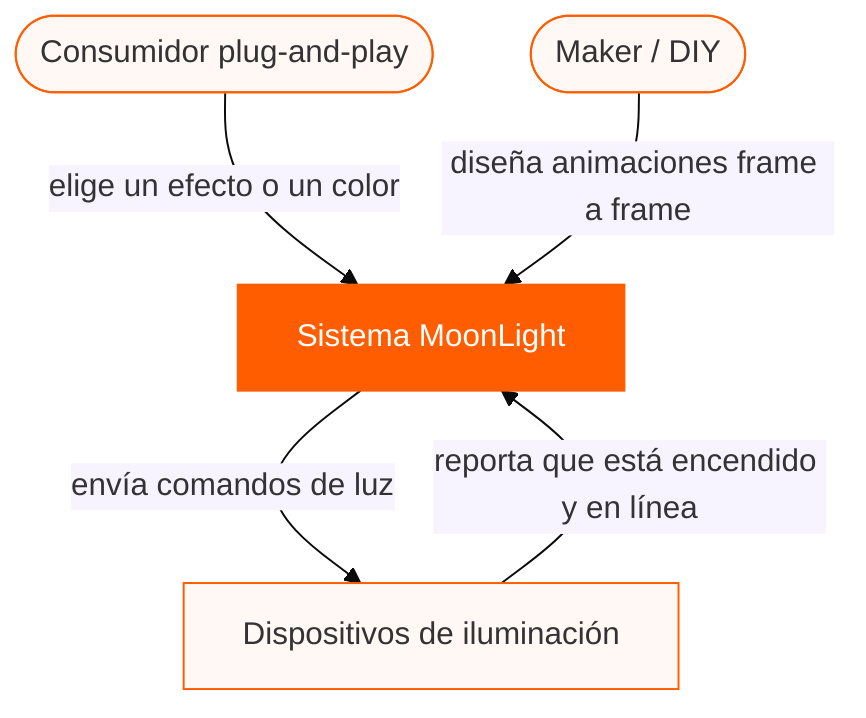
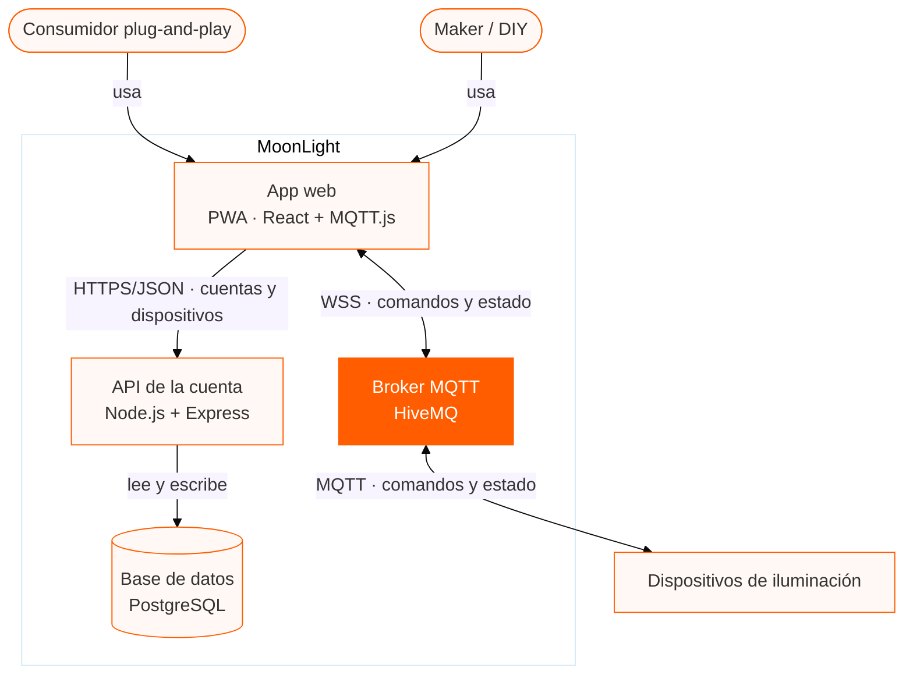
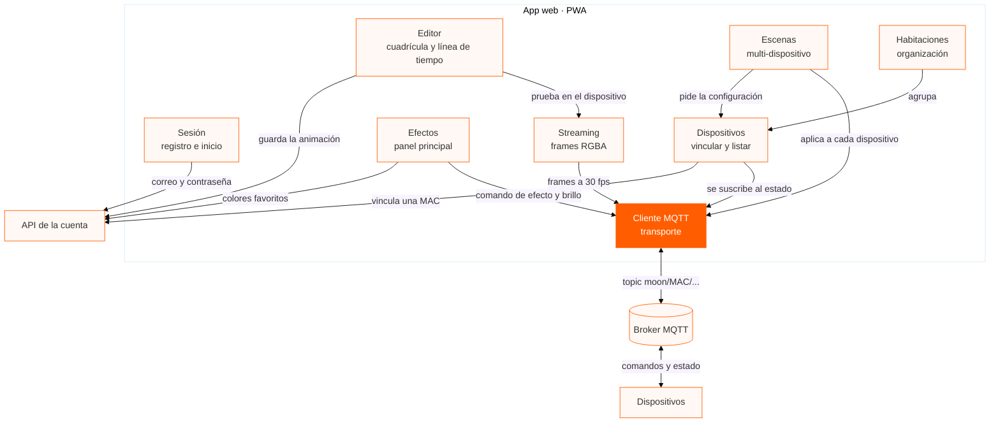
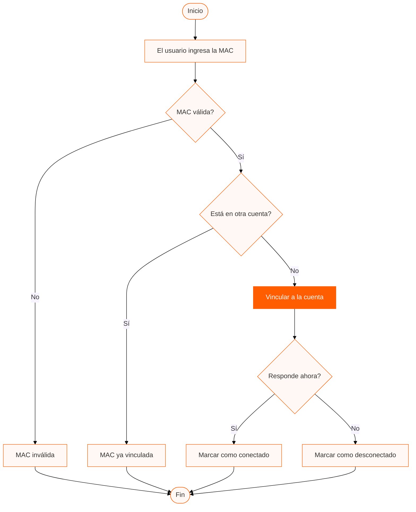
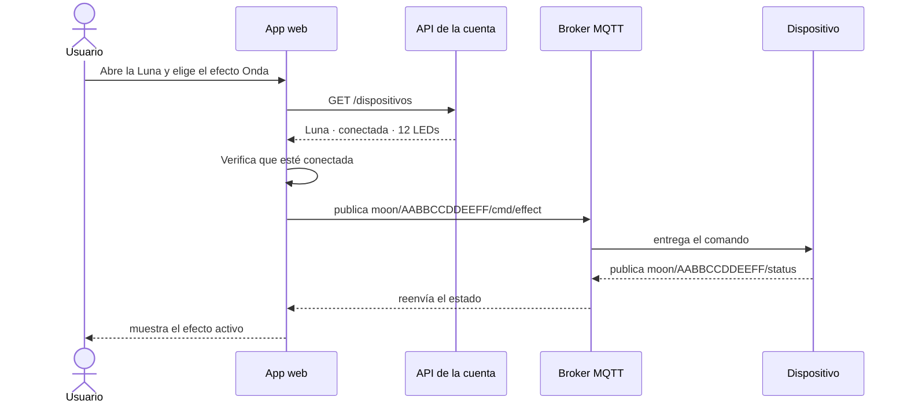
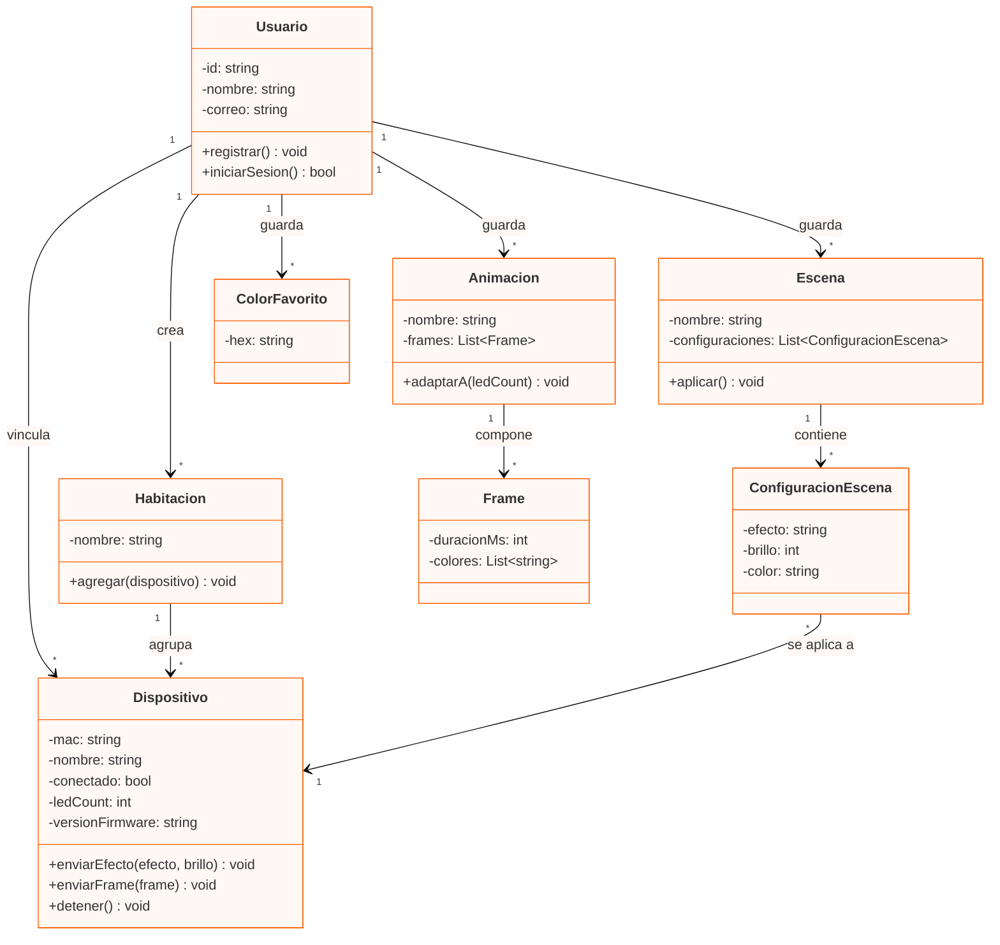
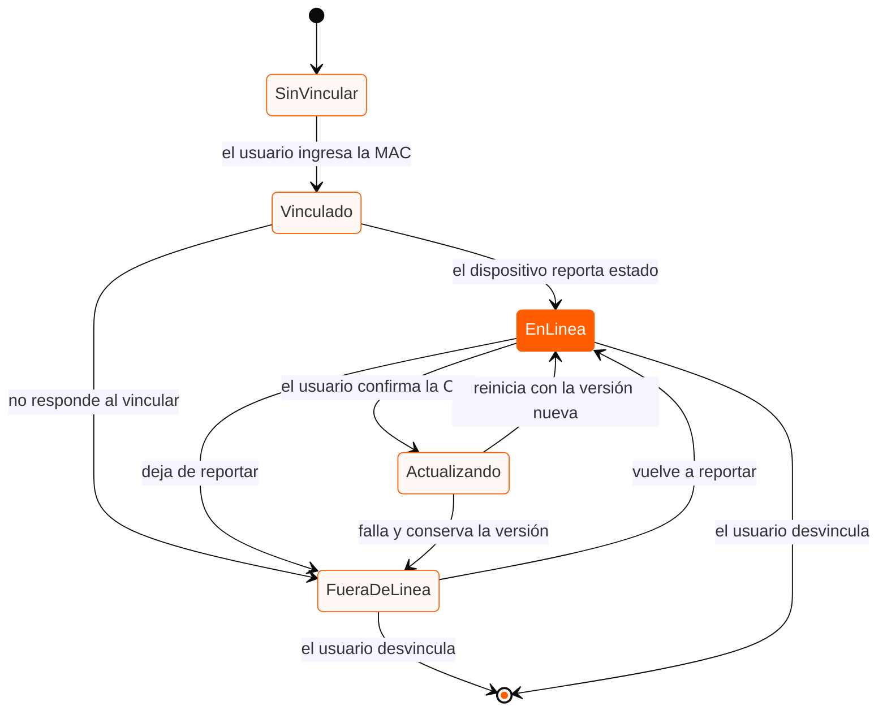
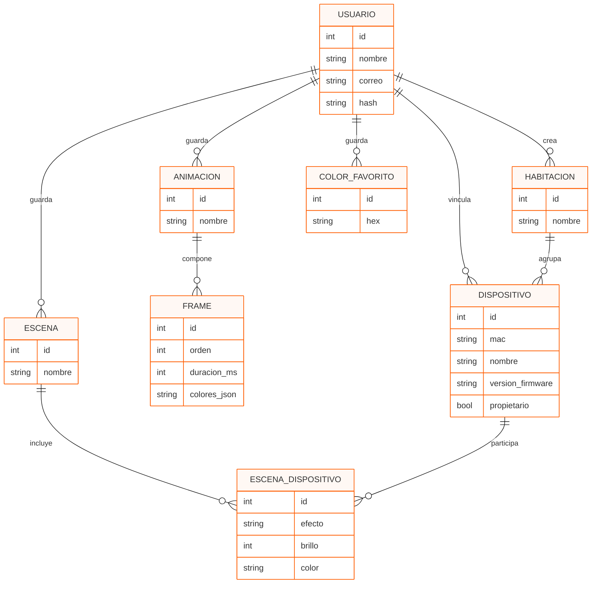

# Diagramas de arquitectura · MoonLight

| Campo | Valor |
|---|---|
| **Sistema** | MoonLight (PWA de control de iluminación sobre MQTT) |
| **Autor** | Jesus Cendejas |
| **Versión** | 1.0 |
| **Fecha** | 2026-10-27 |
| **Fuentes** | `docs/vision-del-producto.md`, `docs/especificacion-requisitos.md` |

Los diagramas van como texto de Mermaid, igual que el código: se comparan entre versiones y se revisan en el mismo diff. Para verlos, pega cada bloque en [mermaid.live](https://mermaid.live).

| # | Diagrama | Tipo |
|---|---|---|
| 1 | [Contexto (C4, nivel 1)](#1--nivel-1--diagrama-de-contexto) | `flowchart` |
| 2 | [Contenedores (C4, nivel 2)](#2--nivel-2--diagrama-de-contenedores) | `flowchart` |
| 3 | [Componentes (C4, nivel 3)](#3--nivel-3--diagrama-de-componentes) | `flowchart` |
| 4 | [Vincular un dispositivo](#4--vincular-un-dispositivo-por-mac) | `flowchart` con decisiones |
| 5 | [Activar un efecto predefinido](#5--activar-un-efecto-predefinido) | `sequenceDiagram` |
| 6 | [Modelo de dominio](#6--modelo-de-dominio) | `classDiagram` |
| 7 | [Ciclo de vida del dispositivo](#7--ciclo-de-vida-de-un-dispositivo-vinculado) | `stateDiagram-v2` |
| 8 | [Modelo de datos](#8--modelo-de-datos) | `erDiagram` |

---

## 1 · Nivel 1 · Diagrama de contexto

El sistema completo visto desde afuera: quién lo usa y con quién habla. No aparece una sola tecnología a propósito — es el diagrama que se le puede enseñar al usuario sin explicarle nada. Los dos actores no son decorativos: son el conflicto que definió el producto, con el consumidor entrando por el efecto en tres toques y el maker por la capa de edición. Los dispositivos quedan fuera de la frontera porque son productos independientes con firmware propio; MoonLight solo los trata como sistemas externos que hablan el protocolo documentado.

---

## 2 · Nivel 2 · Diagrama de contenedores

Las piezas que se despliegan y se ejecutan por separado, con la tecnología de cada una. Aquí sí aparece la tecnología, y el subgraph es lo que dibuja la frontera: el broker va adentro a propósito, porque es parte del contrato del sistema aunque hoy se use el público de HiveMQ y en producción se sustituya por uno propio con ACL por topic (Sprint 5). Lo de afuera solo son los dispositivos. El camino de control va del navegador al broker sin pasar por el backend — así se sostiene la latencia de menos de 500 ms — y la API se queda con cuentas, dispositivos y persistencia.

---

## 3 · Nivel 3 · Diagrama de componentes

Lo que hay dentro del contenedor App web, que es lo que se construye en este proyecto. Dos cosas que el dibujo deja ver: Efectos, Streaming y Escenas no publican por su cuenta, todos pasan por el Cliente MQTT, que es el único que conoce topics y payloads — el patrón Adapter, y lo que hace barato pasar del broker público al propio. Y el Editor no habla con el dispositivo: manda sus frames al Streaming, que ya sabe cómo se reproduce una animación.

---

## 4 · Vincular un dispositivo por MAC

El caso de uso de vincular un dispositivo por MAC (CU-03), que es donde el flujo se puede caer. La caja naranja es el único camino que crea algo; las tres salidas de error terminan en el mismo fin porque para el usuario son el mismo evento: no pasó nada y hay que avisar. Y el dispositivo que no responde igual se vincula, marcado como desconectado — si lo rechazáramos, el usuario con la lámpara apagada no podría registrarla nunca.

---

## 5 · Activar un efecto predefinido

El flujo principal del producto en el tiempo, cruzando los cuatro contenedores. Las flechas sólidas son llamadas y las punteadas son respuestas. Lo importante del dibujo es lo que no pasa: el comando no cruza la API, va del navegador al broker y de ahí al dispositivo. Eso es una decisión de arquitectura, no un detalle de implementación — si el backend tuviera que autorizar cada frame, el streaming a 30 fps no existiría.

---

## 6 · Modelo de dominio

Clases, atributos, métodos, visibilidad y multiplicidad: el signo menos es privado y el más es público. ConfiguracionEscena existe por una razón de requisito — una escena guarda la configuración de cada dispositivo, no una copia del dispositivo — y adaptarA(ledCount) es el requisito de reutilización hecho método: la animación creada para 12 LEDs se manda a una tira de 60 y se adapta.

---

## 7 · Ciclo de vida de un dispositivo vinculado

Por qué estados pasa un dispositivo vinculado y qué evento lo mueve; los corchetes [*] marcan el inicio y el fin. Todo el control de la app depende de una sola pregunta — ¿está en EnLinea? — porque en FueraDeLinea los comandos se bloquean (RF-012). Las dos transiciones que salen de Actualizando son el criterio de aceptación de la OTA (RF-016): si la actualización falla, el dispositivo no se queda a medias, vuelve a reportar con la versión anterior.

---

## 8 · Modelo de datos

Las tablas del backend y cómo se relacionan, con la cardinalidad en los extremos de cada línea: || es uno y exactamente uno, o{ es cero o muchos, o| es cero o uno. ESCENA_DISPOSITIVO resuelve el muchos-a-muchos entre escenas y dispositivos y guarda la configuración de cada uno dentro de la escena. En DISPOSITIVO, mac lleva restricción UNIQUE — el requisito de una MAC por cuenta no es una validación del frontend, es una regla de la base de datos.

---
## Notas de entrega

- Los ocho bloques usan la sintaxis estándar de Mermaid; el tema del curso va en la línea `%%{init: ...}%%` de cada bloque y no se evalúa.
- El nivel 1 no menciona tecnología a propósito: es el diagrama que se le enseña al usuario, no al programador.
- Los niveles 2 y 3 son C4; los diagramas 4 a 8 corresponden al diseño de la Unidad 3 y son un adelanto de UML de la Unidad 4.
